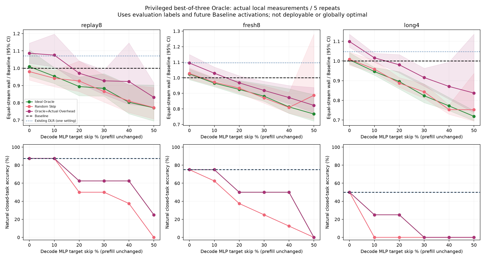

# AI Infrastructure Optimizer

**Reduce the computational cost of AI inference while preserving model accuracy.**

A local experimental research archive covering model/tool routing, selective verification,
generation stopping, Transformer layer skipping, and temporal MLP activation reuse.
It preserves code, raw responses, CSV measurements, checkpoints, scoring audits, tests,
and graphs—including unsuccessful experiments. It is not a production inference server
or evidence of a new independently validated invention.

**Current conclusion:** native MLP bypass can reduce measured execution time, but the
tested DLR and privileged Oracle schedules did not meet their joint accuracy/efficiency
criteria. Earlier routing and verification studies contain limited positive observations.
They do not establish universal savings, production robustness, or monetary ROI.

## What was actually measured

- **Ollama studies:** existing Qwen2.5 0.5B/1.5B model tags, request latency, server-reported
  prefill/generation durations, token counters, process-group CPU, and sampled RSS where available.
- **Model-internal studies:** Qwen2.5-Instruct BF16 checkpoints through MLX on an Apple M4
  with 16 GiB unified memory. Most later studies use the 1.5B/28-layer checkpoint.
  These timings are not directly comparable to Ollama's quantized checkpoints.
- **Compute evidence:** actual native module bypass counters and positive controls;
  dense-matmul FLOPs are analytical estimates, not hardware FLOP counters.
- **Memory:** sampled RSS, MLX allocator peak, and process lifetime high-water marks have
  different scopes; none is automatically exclusive model memory.
- **Unmeasured:** GPU FLOPs/timestamps/kernel counts, power, energy, and actual monetary cost.
  Fewer calls, tokens, or CPU seconds are not interchangeable with those quantities.

Wall-clock request time, server/model processing time, verification-only time, queueing,
shared first-answer generation, calibration, training, and table construction are labelled
separately. Historical demonstrations in `cost_analyzer.py` contain illustrative prices;
they are **not measured inference costs** and do not substantiate savings claims.

## Selected results (different studies, not a pooled leaderboard)

### Model/tool routing: a single 300-task evaluation

| Strategy | Accuracy % | Coverage % | Request time, s | Ollama CPU, s | Model calls | Output tokens |
|---|---|---|---|---|---|---|
| Fixed 1.5B | 70.00 | 100.00 | 20.380 | 23.730 | 300 | 746 |
| Rule-Based | 75.33 | 100.00 | 20.327 | 22.320 | 287 | 741 |
| Confidence-Based | 70.00 | 100.00 | 21.655 | 23.990 | 300 | 746 |
| Hybrid | 80.33 | 100.00 | 14.549 | 15.860 | 240 | 480 |

The dataset has equal arithmetic, knowledge, logic, Python-output prediction, and reading
categories. Hybrid's advantage partly comes from the bounded calculator. Confidence-Based
did not activate small-model routes in this run. Rule-Based incurred format-triggered
fallbacks; per-question regressions and calibration overhead remain in the report.
This is one run, not independent repeated-run evidence.

[Detailed report](data/solver300_c22b83397f0945b4adfb8304f7b2f268_report.md) ·
[CSV](data/solver300_c22b83397f0945b4adfb8304f7b2f268_summary.csv) · [paired assessment](data/solver300_c22b83397f0945b4adfb8304f7b2f268_assessment.md)

### Verification omission: three repetitions of the same 150 tasks

| Method | Content accuracy % | Processing wall, s | Server prefill+decode, s | Ollama CPU, s | Model calls | Output tokens |
|---|---|---|---|---|---|---|
| baseline | 58.00 | 19.461 | 18.217 | 17.243 | 270 | 639 |
| early_exit | 66.67 | 20.294 | 18.942 | 16.223 | 240 | 489 |
| selective | 66.67 | 17.379 | 16.126 | 14.327 | 210 | 428 |
| budget_cap | 58.67 | 21.621 | 20.143 | 19.300 | 270 | 639 |
| batch_verify | 68.00 | 36.231 | 35.214 | 42.860 | 160 | 2099 |

Values are repetition means. Here **Early Exit skips verification**, not Transformer layers.
Selective showed a localized improvement; batching reduced calls while increasing output
tokens and time. Shared questions/greedy outputs are not independent new samples.
Historical scoring and later content-based scoring are retained separately.

[Detailed report](data/efficiency_repeat_1b6d963181b249e0889270ca4590ea2a_report.md) ·
[CSV](data/efficiency_repeat_1b6d963181b249e0889270ca4590ea2a_aggregate.csv) · [original study](data/skipwork_7a7cc6bdb72e495ab9af664ba5b15db7_report.md)

### DLR second optimization: 72 tasks, three repetitions

| Method | Content accuracy % | Baseline token agreement % | Natural wall, s (mean ± SD) | Process CPU, s | Output tokens |
|---|---|---|---|---|---|
| Baseline | 62.50 | 100.00 | 34.072 ± 0.792 | 7.319 | 854 |
| Existing DLR | 61.11 | 97.22 | 35.594 ± 0.981 | 7.762 | 856 |
| Device-Resident | 61.11 | 97.22 | 34.319 ± 0.752 | 7.783 | 856 |
| Lightweight | 62.50 | 95.83 | 35.967 ± 0.989 | 8.098 | 911 |

Times/tokens are totals per 72-task repetition. All methods use the same native-model
conditions except the documented conditional Metal GEMV implementation in Device-Resident
DLR, whose fresh arithmetic has a small numerical difference. Device gate scalar reads were
eliminated during decoding, but ordinary token synchronization remains. Lightweight uses
already observed token IDs; equal IDs do not guarantee equal contextual activations.
Long repetitive generation exposed EOS/counting damage and offsetting correct/wrong transitions.
No method met the joint quality and matched-stream timing goal.

[Full report](data/dlr_opt_2c8a76633b5e450f88242020fce6a899/ANALYSIS_66d8ddb5e3e247a4be9489dcad563887/DLR_OPTIMIZATION_REPORT.md) · [CSV](data/dlr_opt_2c8a76633b5e450f88242020fce6a899/ANALYSIS_66d8ddb5e3e247a4be9489dcad563887/DLR_OPTIMIZATION_RESULTS.csv) ·
[earlier DLR](data/dlr_5a4656b8d37f48dd8a55a0e82b647b37/ANALYSIS_a61966a5b3314aa38e3b4b54517e94f9/DLR_RESEARCH_REPORT.md)

### Zero-Overhead Oracle: 20 tasks, five repetitions

| Condition | Content accuracy % | Natural wall, s (mean ± SD) | Process CPU, s | Output tokens |
|---|---|---|---|---|
| Baseline | 75.00 | 11.060 ± 0.414 | 3.140 | 261 |
| Existing DLR | 75.00 | 11.655 ± 0.496 | 3.407 | 261 |
| Ideal Oracle / 10% | 70.00 | 10.458 ± 0.468 | 2.966 | 259 |
| Ideal Oracle / 50% | 10.00 | 9.534 ± 1.032 | 2.729 | 302 |
| Random Skip / 10% | 60.00 | 11.442 ± 0.742 | 3.097 | 283 |
| Oracle + overhead / 10% | 70.00 | 11.143 ± 0.540 | 3.331 | 259 |

This table is **natural generation**; token lengths differ. The full experiment separately
executes the same Baseline token stream at decode-MLP skip targets from zero through half.
Prefill remains unchanged, so that target is not the fraction of total inference FLOPs saved.
Matched-stream speedups exist at higher rates, accompanied by accuracy damage. The prespecified
joint quality and minimum timing-improvement criterion was not met (classification C).
This does **not** mean physical speedups were absent or every possible DLR schedule is impossible.

**Privileged comparator, not deployable:** the Oracle uses evaluation references and future
Baseline activations to choose the best of a limited candidate set. Construction cost is
reported separately; omitting it from online timing is not end-to-end service savings.
The candidate search is not globally optimal, and Oracle-selected evaluation accuracy is
not independent held-out predictor accuracy.

[Full report](data/oracle_8ef05974726245a1b273f178fc668cb7/ANALYSIS_04d1920008d24b7eba424bc4c451b5f4/ORACLE_EXPERIMENT_REPORT.md) · [all rates/CI](data/oracle_8ef05974726245a1b273f178fc668cb7/ANALYSIS_04d1920008d24b7eba424bc4c451b5f4/ORACLE_COMPARISONS.csv) ·
[CSV](data/oracle_8ef05974726245a1b273f178fc668cb7/ANALYSIS_04d1920008d24b7eba424bc4c451b5f4/ORACLE_OVERALL_RESULTS.csv)



### Adaptive stopping: a qualified observation, not a semantic correctness oracle

On the fresh cohort, the limited requested-fact audit was 82.81% for Baseline and
82.81% for Adaptive Stop; wall totals were 39.687 s and 36.424 s.
This is **not full semantic accuracy**: a posthoc doctor/physician scoring correction and
unrequested additions are disclosed. Boundary/confidence stopping sometimes returned only
`Dr.`. Fixed caps were faster partly by truncating tasks.

[Scoring audit and report](data/acs_16a7001279c947c0acb730672deb1a97/ANALYSIS_f4146c33e0184a62aef399eaaaa7f53d/ACS_RESEARCH_REPORT.md) · [audit CSV](data/acs_16a7001279c947c0acb730672deb1a97/ANALYSIS_f4146c33e0184a62aef399eaaaa7f53d/AUDITED_RESULTS.csv)

## Research map and complete evidence

[Research ledger](docs/RESEARCH_LEDGER.md) records goals, methods, models/hardware, datasets,
repetitions, measured outcomes/resources, comparisons, failures, limitations and next findings.
It links initial benchmarks, Adaptive/Coverage/tool routing and mixed-task audits; Rule/Confidence/
Hybrid; Early Exit/Selective; RCAV and controlled verification; VVP/VRG/PVCG; ALSR and layer
impact/Stable Runtime; ACS; DLR/activation reuse; Device/Lightweight; and Oracle.

DLR is an **activation-reuse mechanism**, not a separately validated second invention.
Transformer-layer early exit, verification omission, and output stopping are different
interventions. No successful general-purpose compute-saving technology is claimed.
Adaptive Precision has **not been started** and is not a completed experiment here.

## Reproduce safely

Run these commands from this project subdirectory. Offline checks do not call models:

```sh
python3 -B tools/verify_publication.py
python3 -B tools/verify_readme.py
python3 -B tools/run_tests.py
# Optional numerical tests in an environment with NumPy:
python3 -B -m unittest tests.test_oracle tests.test_alsr_impact.TestDistributions tests.test_alsr_impact_ties tests.test_alsr_impact_analysis
```

An actual local Ollama request/benchmark (requires the existing models/server, no paid API):

```sh
python3 -B -m src.routing_runner --question "4 + 1"
python3 -B -m src.benchmark_v2
```

Historical MLX jobs additionally pin local checkpoint files and versions. Exact old private
fingerprints/paths are not silently rewritten to make public replays appear authentic.
[Reproduction and public-copy limitations](docs/REPRODUCIBILITY.md) explains the explicit
publication-aware launcher and local-model prerequisites. Existing usage/design documents
and commands remain preserved. New runs must not call already-used questions unseen.

## Publication integrity and limits

Private absolute project paths are sanitized only in the public copy. Numerical CSV values
are preserved; [fact locators](docs/README_FACTS.json) make the README tables machine-checkable.
Original run hashes refer to original bytes; publication hashes describe this reviewed copy.
[Publication notes](PUBLICATION_NOTES.md) and [lineage](publication/LINEAGE.json) distinguish them.
Earlier public versions are archived and other portfolio projects are unchanged.

Synthetic English tasks, limited sample sizes, reused outputs, posthoc scoring audits,
cache/order/thermal effects, and incomplete resource measurement limit generalization.
These experiments are evidence to inspect, not production guarantees or claims of novel IP.
